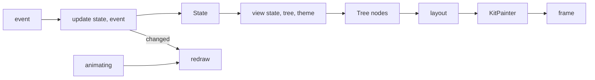
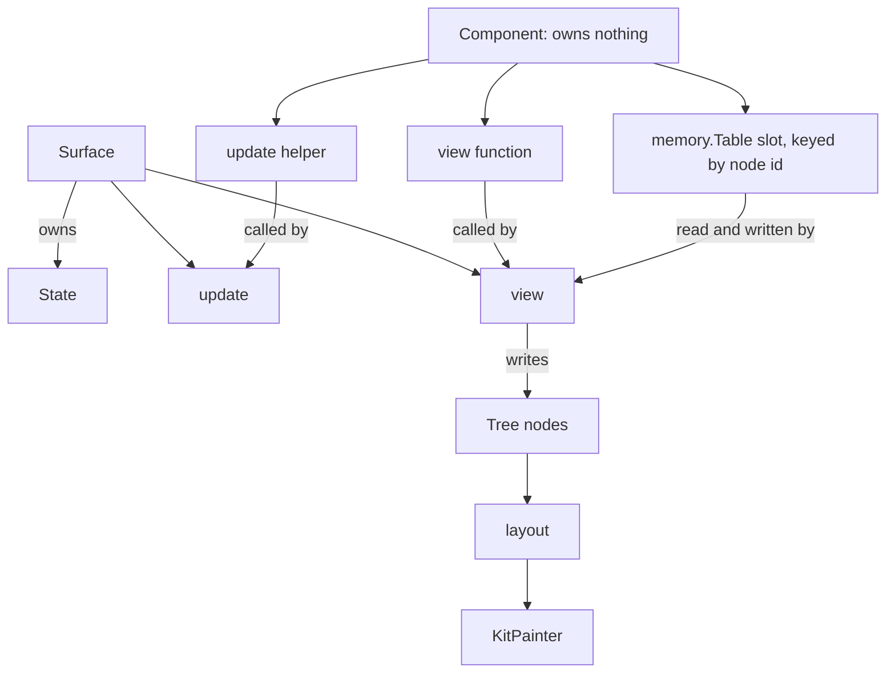

# UI kit

The kit draws Rex's own interface: transient surfaces in the terminal window
and settings and the wellbeing dashboard in their own windows. The decision
behind it is ADR 0008 (`docs/decisions/`), with the state and view model in
ADR 0009. This page is the working spec: the model, the components and how
to add one.

The kit imports nothing outside this folder. It does not know about the
terminal, the driver or OpenGL, so it runs in any process and its tests need
no display. Painting is `renderer/KitPainter.zig`; text is measured through
the `text.Measurer` a caller passes in.

## The model

A **surface** is one whole piece of interface: the toast stack, an alert
dialog. Its **State** is one plain struct holding everything about it,
including which control is hovered, pressed or focused. Modes are enums or
tagged unions. **`update(state, event)`** is the only function that changes
the state, one exhaustive switch. **`view(state, tree, theme)`** writes the
surface as a flat array of boxes, texts and icons into a `Tree`, rebuilt from
the state every time without reading the previous view.

A **component** owns nothing. It is a view function the surface calls with
values, such as `button.view(tree, theme, .{ .label = ..., .state = .hovered })`;
a helper the update calls, such as `focus.move` or `dialog.Phase.tick`; or a
slot in a `memory.Table` keyed by a node id, such as the last drawn position
of a toast.

There are no widget objects that keep their own state and call back. The
state of a control lives in the surface that shows it, once.

Rules that hold everywhere: nothing allocates in update, view, layout or
paint. Buffers are fixed and their sizes are checked at compile time
(`node_max`, `line_max`); running out is an error, never a silently missing
node. Sizes are logical pixels, multiplied by the display scale once and
snapped to physical pixels in `layout.snap`. A component names tokens of
`Theme`, never a color or a radius of its own. A button is taken when the
pointer is let go, not when it goes down; the toast close mark and the scrim
still act on the press.

## Terms & Concepts

| Term | Meaning |
| --- | --- |
| **Node** | One flat entry in a `Tree`: its input rules (`box`, `content`), its computed `rect`, and the `parent`/`end` bounds of its children. |
| **Box** | The input half of a node: size, padding, gap, axis, alignment, fill, border, id and pointer shape. A view opens and closes boxes; layout later turns them into rectangles. |
| **Root** | A node at the top level laid out against the window. A view writes one or more in drawing order; a root can be anchored to an earlier one. |
| **Overlay child** | A node with `overlay = true`, drawn over its parent's padding box and not counted in the parent's size. |
| **Container** | Any box whose purpose is to hold children, written with an `open`/`close` pair. The caller closes what it opens. |
| **Card** | The bordered `theme.card` container from `card.zig`, with composable header, content and footer slots. |
| **Field** | `field.zig`'s label, optional description and badge, a control slot, and an optional validation error line below the row. |
| **Group** | `button_group.zig` / `input_group.zig`: a focus ring and a group box with segment or addon children. The surface owns selection and focus. |
| **Scroll region / ScrollArea** | A scroll region is one node registered with `Tree.scrollRegion`; a view can register up to `Tree.Scroll.max` (8) of them. A `ScrollArea` is the clipped viewport plus the overlay thumb appended by `scroll_area.close`. |
| **Layer / Scrim** | A layer is a node covering the whole window, drawn over the page, as `popup.open` writes; a scrim is the modal backdrop under a dialog or lock screen that takes the pointer away from the page. |
| **Component vs Surface** | The distinction drawn below: state belongs to the surface, never to a component. |

Notices follow the same split: a **callout** is a notice inside the page, a
**field** error validates one control, and the **alert** is a transient overlay
banner. Do not use one where another is meant.

## Files

| File | What it holds |
| --- | --- |
| `Theme.zig` | Tokens: colors in a dark and a light variant, radii, the spacing step, control heights, durations |
| `text.zig` | Text styles, the measurer interface, line wrapping |
| `icons.zig` | Code points in the bundled icon font |
| `Tree.zig` | The node array a view writes, ids, hit-testing |
| `layout.zig` | Rectangles for every node; logical to physical pixels |
| `memory.zig` | Per-id memory that outlives a rebuild of the view |
| `motion.zig` | The one duration and curve every surface uses |
| `focus.zig` | Keyboard focus order over a row or list |
| `button.zig`, `badge.zig`, `kbd.zig`, `dialog.zig`, `sidebar.zig`, `popup.zig`, `tabs.zig`, `chart.zig`, `tooltip.zig` | Components |
| `callout.zig`, `separator.zig`, `card.zig`, `collapsible.zig`, `field.zig`, `scroll_area.zig`, `button_group.zig`, `input_group.zig` | In-page layout components |
| `checkbox.zig`, `switch.zig`, `slider.zig`, `input.zig`, `select.zig`, `toggle.zig` | Control views |
| `toast.zig`, `alert.zig`, `alert_dialog.zig`, `lock_screen.zig`, `wellbeing_widget.zig` | Surfaces |

## Text

Sizes are logical pixels and do not follow the system font size. A text
is `.proportional` unless it asks for `.tabular`: each ASCII digit then
sits in one cell as wide as the widest digit, and is not kerned.

| Style | Size / line | Weight | Tracking | Used for |
| --- | --- | --- | --- | --- |
| `xs` | 12 / 16 | medium | 0 | key caps, captions |
| `sm` | 14 / 20 | regular | 0 | body text |
| `sm_medium` | 14 / 20 | medium | 0 | buttons, toast titles |
| `base` | 16 / 24 | regular | 0 | settings body |
| `lg_semibold` | 18 / 28 | semibold | 0 | dialog titles |
| `xl_semibold` | 24 / 32 | semibold | 0 | card values |
| `display_sm` | 36 / 42 | regular | −1 | compact display values |
| `display_md` | 44 / 52 | regular | −1 | medium display values |
| `xxl_semibold` | 56 / 64 | semibold | −1 | compact timer |
| `xxxl_semibold` | 80 / 88 | semibold | −2 | timer |

## Layout

A box places its children in a row or a column, with padding around them and
a gap between them, aligned along and across its axis. A width or height is
one of:

| Size | Meaning |
| --- | --- |
| `fit` | As large as the content |
| `fill` | A share of what the parent has left |
| `fixed` | This many pixels |
| `at_most` | This many pixels, or less in a smaller parent |
| `fit_at_most` | As large as the content, capped at this many pixels |
| `at_least` | As large as the content, but not below this many pixels |
| `fraction` | This fraction of the parent's inner size, from 0 to 1 |

Text wraps by words (`.word`), breaks only on line feeds (`.none`), or
truncates a single line with `"…"` (`.ellipsis`). A row with `.wrap = true`
breaks overflowing children onto additional lines.

A box with `.overflow = .clip` cuts its descendants at its rectangle (and
along its rounded corners when `radius > 0`), keeping their sizes instead of
shrinking the largest one to fit. Clipping boxes nest up to 8 deep and up to
`Tree.Scroll.max` regions can scroll on `x` and `y` via `Tree.scrollRegion`.

Roots are laid out one after another in drawing order, each against the
window. A root can instead be anchored to a node of an earlier root
(`Tree.anchorTo` / `Tree.anchorToWith`, at most `Tree.anchor_max` per view):
it is placed on the requested side (`.auto`, `.below`, `.above`, `.left`,
`.right`), flips when clipped, stays inside the viewport margin, and matches
the anchor's width when `match_anchor_width = true`.

## Components

### Button (`button.zig`)

| | Values |
| --- | --- |
| Variant | `outline`, `primary`, `ghost`, `destructive`, `secondary`, `link` |
| Size | `default` (36 px), `xs` (24 px), `sm` (32 px), `lg` (40 px) |
| State | `normal`, `hovered`, `pressed`, `disabled` |
| Also | `focused` draws the ring; `key_cap` shows a key after the label; an empty label with `icon` makes a square button at any size |

The focus ring sits in a slot around the face, so a row does not shift when
the focus moves. The button's id is on that slot. A disabled button is drawn
at half opacity and gets neither hover nor focus from its surface.

### Kbd (`kbd.zig`)

`kbd.view` draws one key cap; `kbd.group` draws several in a row. A key cap
is at least as wide as it is tall. It only displays a key; the caller binds
it.

### Badge (`badge.zig`)

Read-only status or metadata pill (`default`, `secondary`, `muted`, `outline`,
`destructive`, `info`, `success`, `warning`) in `sm`, `default`, or `lg` size,
with an optional leading icon. Maps cleanly to `Theme` tokens with no caller
color state.

### Dialog (`dialog.zig`)

`dialog.open` .. `dialog.close` write the scrim and the card. Inside the
card go `dialog.header` (with `dialog.title` and `dialog.description`) and
`dialog.footer` (a row of buttons). What opens a dialog is an event to its
surface. `dialog.Phase` (closed, entering, open, leaving) fades it in and out; a
surface keeps one in its state. The card's width is an upper bound: in a
narrower window it shrinks and keeps a 16 px margin.

### Sidebar (`sidebar.zig`)

The frame of a tool window: sections grouped under headings in a 256 px
column, the pane with the current section beside it, and a button at the top
of the pane that shows and hides the column. A view calls `sidebar.begin`,
writes the section, then `sidebar.end`; the surface keeps a `sidebar.State`.

Below 600 px of width the column is hidden. Shown from there, it lies over
the pane, which is dimmed; a click on the dimmed part or choosing a section
puts it away. Crossing 600 px hands the choice back to the width. Up and
Down move between sections and stop at the ends; Home and End jump to the
first and last.

### Tabs (`tabs.zig`)

Two variants: `default` is a track `control_sm` tall (32 px) filled with
`muted`, with 3 px of padding; `line` is transparent with a 2 px foreground
indicator just inside the bottom (or right, when vertical) of the current
face. The current tab of the default variant is a face of `horizontal_face_height`
(26 px): `background` in the light theme, and `input` at 30% with an `input`
border in the dark theme. Other labels are `muted_foreground`; the label
under the pointer is `foreground`. Focus draws the ring as that face's border,
so the row does not grow.

`orientation` is `horizontal` (the default) or `vertical`. A vertical track
sizes itself and has no equivalent of `horizontal_width`; its faces use
`vertical_min_height` (32 px) as a minimum and are taller once text and
padding are counted. The surface keeps the current, hovered and focused
indexes and draws the page itself.

### Callout (`callout.zig`)

An in-page notice with `default` and `destructive` variants. A surface opens
`view`, writes `title` and optional `description` into the returned frame,
then calls `close`. The destructive variant tints the title destructively and
the description at 90% of that colour. It owns no state or timer; the surface
decides when it is shown. It is distinct from the transient alert banner and
from a field's validation line.

### Separator, card, collapsible, field and scroll area

`separator.view` writes a 1 px divider, horizontal or vertical. `card.open`
opens a bordered `theme.card` panel with composable header/content/footer
slots; the caller closes what it opens. `collapsible` opens a card with a
disclosure trigger and a content body. `field.open` writes a label, optional
description and badge, a control slot and an optional validation error; its
`Frame` carries the boxes to close. `scroll_area.open` opens a clipped viewport
and registers one scroll region; `scroll_area.close` appends the overlay
thumb. A view can register up to `Tree.Scroll.max` (8) independent scrolling
clip boxes.

### Button and input groups (`button_group.zig`, `input_group.zig`)

Both open a focus ring and a group box, with `openSegment` / `openAddon` for
their children. The surface owns selection and focus; the views only draw.

### Controls

`checkbox`, `switch`, `slider`, `input`, `select` and `toggle` are view
functions taking their current value and state in `Options`. They keep no
state: the surface stores the value, hover, focus and disabled flags and
passes them in.

### Chart (`chart.zig`)

Three views, each taking its numbers and a mark. `progress` is a `bar` or
a `ring`, `share` is a `bar` or a `donut`, and `days` is a `bar`. The ring
and the donut are arcs: a square whose slices are drawn over it. `days`
draws one column per day at a fixed height, with `part` at the bottom of
`total` and, when a limit is given, a 1 px `border` strip at that value.

### Tooltip (`tooltip.zig`)

A card anchored to a node, written after the page. It has no layer covering
the whole window, and the card has no id, so the page under it still takes
hover and clicks. `tooltip.line` writes an 8 px swatch, a name and a value in
`xs`.
The surface decides when the card is open.

### Popup (`popup.zig`)

A card above the page, placed against the control that opened it: the list
of a dropdown, a menu. `popup.open` writes a transparent layer over the
whole window and opens the card, anchored to the control; `popup.item`
writes a row (filled when highlighted, checked when selected); `popup.close`
ends the card. Write it after the page. The card takes the pointer over
itself and the layer everywhere else, so the page gets neither hover nor
clicks while it is open; a press on the layer is the surface's cue to close
it.

## Surfaces

### Toast stack (`toast.zig`)

Up to three toasts at the bottom right, the newest lowest; more wait their
turn. Kinds: `default`, `success`, `info`, `warning`, `err`. A
toast leaves when its time is up; the time stands still while the pointer is
over the stack.

### Alert banner (`alert.zig`)

A transient banner for a config error. It owns phase, motion and placement
(`floating` or `docked`) in its state; the surface ticks it and decides when
to show it. It has an icon, a title, an optional body and a close button, and
stays until it is answered or dismissed. This is the overlay notice; an
notice inside the page is a callout and a message for one field is
`field.errorText`.

### Alert dialog (`alert_dialog.zig`)

Built from the dialog parts: an optional icon (`Request.media`), a title, an
optional body and one to three actions. An action with role `dismiss`
cancels; one with role `choose` answers.

It interrupts with one question and stays until it is answered. Choosing an
action closes it at once and reports which; dismissing fades it out. The
caller decides what a click on the scrim does.

## Seeing it

`xvfb-run -a zig build -j2 test -Dtest-filter=KitPainter -Dkit-shots=<dir>`
writes frames of every surface as PPM files. The specimen sheet has its own
taller frame and produces `specimen-dark-100` and `specimen-light-100`:
every component in both themes, with every variant, size and state. It also
has a mark and presence/geometry assertion per component. Look at the
specimen after any change to a component, and add new components and variants
to it (`renderer/kit_painter_test.zig`).

## Adding a component

1. Take the name and composition an established component library uses for
   it, so the parts have names people already know.
2. Write it as a view function in its own file, with an `Options` struct and a
   `node_max`. Modes that exclude each other are one enum, not several bools.
3. If it has behaviour several surfaces need, add a helper that a surface's
   update calls. Keep the state in the surface.
4. Test it without a display: build a tree, lay it out, assert the nodes.
5. Add it to the specimen sheet and to the tables above.

## Planned

Specified here when built, in the ticket that first uses them: a focus order
taken from the view, for surfaces with many controls.
